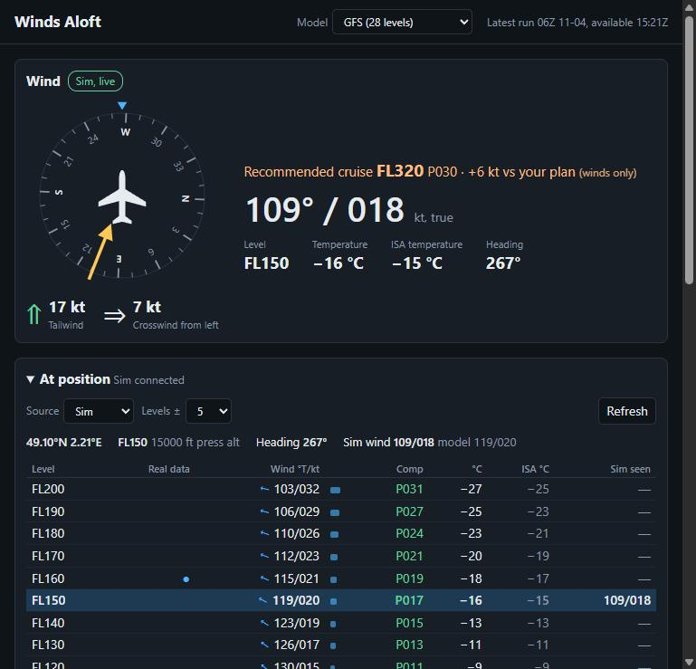

# Winds Aloft

A small Windows tool for Microsoft Flight Simulator. It shows the winds around your aircraft level by level, in 1,000 ft steps, and updates the winds along your latest SimBrief flight plan.

For flight simulation only. Do not use it for real-world navigation.

> **Beta:** tested on Microsoft Flight Simulator 2020. MSFS 2024 hasn't been tested. Please report problems under Issues.




## Requirements

- Windows 10 or 11, 64-bit
- An internet connection, for forecasts and SimBrief
- For live sim data: Microsoft Flight Simulator and Microsoft's 64-bit `SimConnect.dll`, which **isn't included**. Many PCs with flight sim add-ons already have a copy, and the tool looks for it automatically. If it isn't found, see [If it can't find SimConnect.dll](#if-it-cant-find-simconnectdll)
- Without the sim or `SimConnect.dll`, you can still check your SimBrief route and recommended cruise level

## Features

- Live sim wind, temperature and ISA temperature, with a compass showing the wind relative to your aircraft, plus headwind and crosswind components
- Forecast winds for every 1,000 ft level above and below your position
- A record of the winds the sim reported as you passed through each level
- Your latest SimBrief plan compared with fresh forecast winds at each waypoint's level and time, with an estimated change in flight time
- A Sim est. column: an estimate of the sim's winds along the route, based on the difference measured between the sim and the forecast at your aircraft
- Winds for any custom point and altitude, for when your route changes. Enter coordinates, a plan waypoint, or, with the sim running, any fix, VOR, NDB or airport in its navigation database
- A recommended cruise level, from FL290 to FL510, for your direction of flight. With a SimBrief plan, it picks the lowest estimated fuel per ground mile, using wind, temperature, the plan's Mach and a generic penalty for leaving the plan's level. Without a plan, it uses wind only. It's an estimate that isn't specific to your aircraft and doesn't check its ceiling, so don't use it for fuel planning
- A choice of GFS or ECMWF IFS forecast data

## Getting started

1. Download `WindsAloft.exe` from Releases and double-click it. The tool opens in its own window, using the Microsoft Edge that comes with Windows. If Edge and Chrome are both missing, it opens in your default browser instead.
2. Start the sim. The page connects by itself.
3. To see your route, enter your SimBrief Pilot ID or username and click **Load latest plan**.

Close the window to stop the tool. Windows or your antivirus may warn about an unknown program the first time, because the file isn't signed. Choose **More info**, then **Run anyway**.

## If it can't find SimConnect.dll

The tool needs Microsoft's `SimConnect.dll` to read the sim, and doesn't include it. It looks in these places:

1. Next to `WindsAloft.exe`
2. The MSFS SDK folders `C:\MSFS SDK` and `C:\MSFS 2024 SDK`
3. Other programs in `Program Files`, as many flight sim add-ons install a copy

If none is found, install the MSFS SDK (in the sim, enable Developer Mode, then use its Help menu), or copy `SimConnect SDK\lib\SimConnect.dll` next to the program. The 64-bit version is required. Without it, you can still use **Manual** position and the SimBrief route.

## How accurate the levels are

- The forecast models publish data at fixed pressure levels, not every 1,000 ft. Rows are interpolated between the two nearest levels, and a ● marks rows within 150 ft of real model data.
- GFS has about 2,000 ft between levels at cruise, and ECMWF IFS has about 4,000–5,000 ft.
- Levels are pressure altitudes, and wind directions are true.
- The sim only reports the wind where your aircraft is, so other levels and the route ahead come from the forecast, which may differ from the winds in your sim. Sim est. narrows that gap near your aircraft, but it's still an estimate.
- SimBrief's own plan isn't changed, because it has no documented way to accept custom winds.

## Run from source

Needs Python 3 on Windows, with no extra packages.

```bash
python server.py
```

Add `--demo` to use a fake flight without the sim.

To build `dist\WindsAloft.exe`:

```bash
pip install pyinstaller
```

```bash
build.bat
```

## Data and privacy

Weather data comes from [Open-Meteo.com](https://open-meteo.com/) ([CC BY 4.0](https://creativecommons.org/licenses/by/4.0/)), using NOAA GFS and ECMWF IFS. Its free service is for non-commercial use and has call limits.

The tool only reads from the sim. Its window sends waypoint and aircraft positions to Open-Meteo, and your SimBrief ID to SimBrief. Your ID is saved only on your PC.

## Licence

Winds Aloft is free to use, copy and modify under the [MIT License](LICENSE). See [third-party notices](THIRD_PARTY_NOTICES.md) for the other parts it uses.

Winds Aloft is an independent project, not affiliated with or endorsed by Microsoft, Asobo Studio, Navigraph, SimBrief, Open-Meteo, NOAA or ECMWF.
